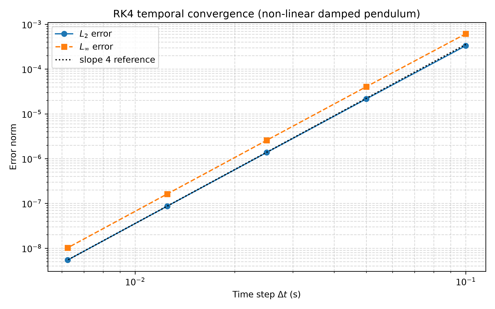

# RK4 Pendulum Convergence Study

A fourth-order Runge-Kutta solver for the non-linear damped pendulum, validated against an 8th-order DOP853 reference.

## Results

- Empirical order of convergence: p = 3.95, 3.97, 3.99, 3.99 over four time-step halvings
- RK45 and Radau energy histories agree to about 5e-10 J
- 3 pytest tests: undamped energy conservation, monotonic dissipation, 4th-order accuracy

## Run it

    pip install -r requirements.txt
    python src/convergence_study.py
    python -m pytest tests/
